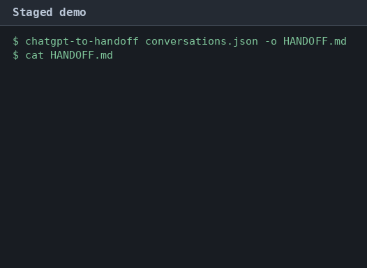

# chatgpt-to-handoff

`chatgpt-to-handoff` turns one ChatGPT conversation into a Markdown file that Codex, Claude Code, or Cursor can read.



## Quick start

1. In ChatGPT, open Settings, then Data controls, then Export data. Download the zip from the email OpenAI sends.
2. Install the command with `pipx install git+https://github.com/kamilkaczmareksolutions/chatgpt-to-handoff` or run it once with `uvx --from git+https://github.com/kamilkaczmareksolutions/chatgpt-to-handoff chatgpt-to-handoff`.
3. Write the handoff. If the export contains one conversation, this is enough:

```bash
chatgpt-to-handoff ~/Downloads/export.zip
```

The command writes `HANDOFF.md` in the current directory.

## Examples

List the conversations in an export. This writes no file.

```bash
chatgpt-to-handoff export.zip --list
```

Pick one conversation by id or by its exact title.

```bash
chatgpt-to-handoff export.zip --id 6f1c2a40-1111-4000-8000-000000000001
chatgpt-to-handoff conversations.json --title "Ship the parser"
```

Read a public share link. The command requests `https://chatgpt.com/backend-api/share/<id>` and uses the same branch walk as an export.

```bash
chatgpt-to-handoff "https://chatgpt.com/share/69b1c492-1540-8006-aa29-ee2e0a831385"
```

Write `AGENTS.md` instead of `HANDOFF.md`.

```bash
chatgpt-to-handoff export.zip --agents-md
```

You can also pass `conversations.json`, a shard named `conversations-001.json`, or a directory that contains those files.

## What the file contains

The file has a title, the source name, and the conversation id. Then it has these sections.

- Goal and context. This is the first visible user message, unless a later user line starts with goal, context, or objective.
- Decisions. Lines that say decided, decision, we will, we'll, let's go with, or chosen approach.
- Requirements. User lines that are list items, or that say must, should, or requirement. The file keeps the first 40 unique lines.
- Open questions. User or assistant lines that end with `?` and sit outside a code fence.
- Code. Fenced blocks from the visible messages.
- Transcript. The visible active branch, inside a collapsed `details` block.

A section with no matches contains the line `_None extracted._`.

The active branch is the chain of parents from `current_node`. Edits on other branches stay out of the file. The same input produces the same bytes. The command does not call a language model.

These are the patterns the command matches. A line is tested after the code fences are removed.

Goal line: `(?i)^(goal|context|objective)\b`

Decision line: `(?i)\b(decided|decision|we will|we'll|let's go with|chosen approach)\b`

Requirement line: `(?i)\b(must|should|requirement)\b`

List item: `^(?:[-*+]|\d+[.)])\s+(.+)$`

## Limitations

The share URL is an unofficial endpoint. OpenAI can remove it, or answer 403 from some networks. A private or deleted share fails, and the command leaves the output path untouched. Tests never call the network.

Non-text parts become the placeholder `[image]`. The command does not copy images, audio, or files from the export.

Tool-role text is omitted. A corrupt `conversations*.json` file fails the whole load. Nested zips stop at depth 8. Archives that are not ZIP64 and are larger than 4 GiB fail. A directory scan reads `conversations*.json` files and does not open zip files inside that directory.

## License

MIT. See `LICENSE`.
